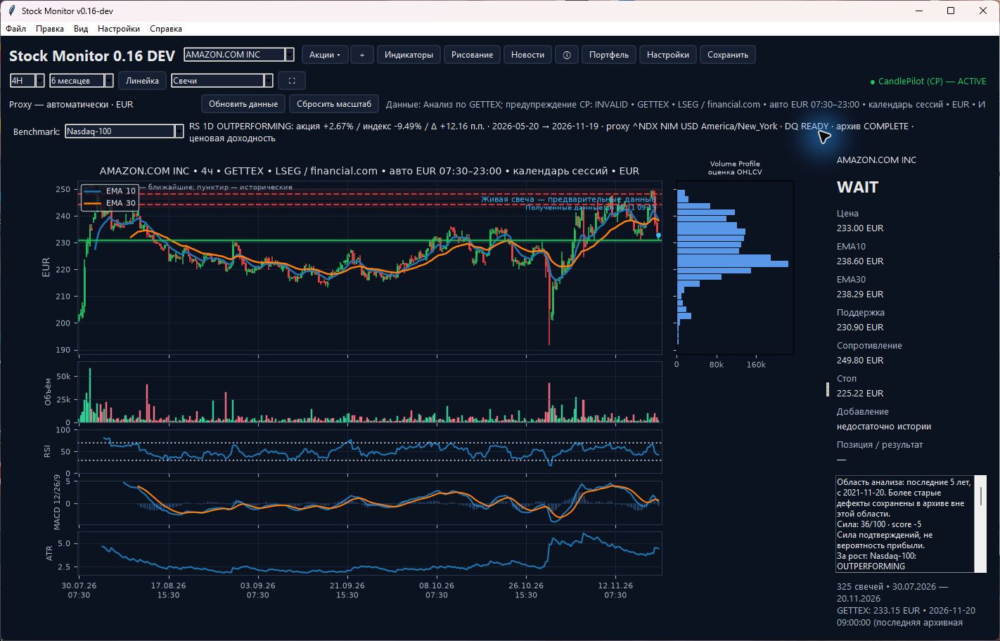

# Issue #20 — GETTEX-first, внедрение и приёмка

20.11.2026, Europe/Berlin. **PARTIAL: установлен рабочий слой, приёмка всего эксперимента ещё не завершена.**

Ветка `work1/gettex-first-issue20`, [draft PR #21](https://github.com/swindler2010/StockMonitor/pull/21), база `work1/trading-priority-20261110`. Это продолжение первого слоя `ef62867`, а не новый торговый движок. Не считать документ подтверждением готовности всех 58 акций или прибыльности стратегии.

## Что изменилось

1. `gettex_first`: отдельные `data_present`, `indicator_computable`, `analysis_available`, статус проверки и число DQ-предупреждений. Квитанция доступности не разрешает исполнение сделки. Подтверждённый ISIN/listing, точный поставщик, GETTEX/EUR, часовой пояс и корректные фактические OHLCV обязательны.
2. Существующие агрегация, индикаторы и CORE используют сохранённые реальные бары при GAP/UNCONFIRMED/INVALID/STALE/SOURCE_GAP/RECOVERING. Исходные отчёты DQ и фактические `bar_complete=False` сохранены. Отсутствующие интервалы не заполняются; нулевой опубликованный объём не превращается в придуманную сделку. Реально некорректные значения и недостаточный массив остаются непригодными.
3. Устранены барьеры prove_scope и display-only/сегментных индикаторов для подтверждённого фактического ряда. Вместо вымышленного доказательства устойчивости указан расчёт по доступным реальным барам; старый строгий путь других источников сохранён.
4. Выбор длинного целого GETTEX-архива больше не проигрывает короткому только из-за DQ-подозрения. Исправлен также ранний возврат короткого источника с более свежим концом для старших TF. Для оперативных 5m/15m сохраняется существующий выбор целого свежего ряда, оба архива остаются отдельно; хвосты разных поставщиков не склеиваются.
5. PAPER использует эти расчёты с прежними самостоятельными проверками исполнимой котировки, сессии, фактического OHLCV, listing, ревизий, срока расчёта, средств, позиции, стратегии и риска. Предупреждение архива само не отклоняет свежую корректную цену. Нулевая ликвидность цены исполнения, устаревание и неверные границы свечи остаются отказами.
6. Последовательная подготовка больше не ждёт DQ/котировку другой акции. Допуск анализа отделён от наличия цены исполнения. После двух оперативных ходов при наступившем сроке выделяется один слот существующей очереди следующему кандидату: растущий список подключённых акций больше не занимает все свободные ходы.
7. Аналитическое чтение и подготовка графика используют одну согласованную WAL-транзакцию, затем окончательную проверку живых ревизий. Полная копия БД для каждого чтения не создаётся. Для явно отмеченных фактических входов классификация DQ является аудитом, а не причиной отзыва расчёта; свечи, listing и условия разрешения остаются защищены.
8. Запрос PAPER runtime отделён от незаказанной полной диагностики CandlePilot. В поле CP возвращается явное NOT_READ со ссылкой на отдельный раздел, без нулей вместо отсутствующих данных. Полная диагностика CP остаётся отдельной тяжёлой операцией.
9. В существующий журнал добавлены `paper_data_decision`: фактические входные диапазоны и отпечатки, рыночные ревизии, точный источник, значения EMA/RSI/MACD/ATR/объёма, предупреждения, сигнал стратегии и причина решения. Запись выполняется при изменении контекста; прежние сделки не переписываются. Те же сведения включены в квитанцию автоматического исполнения.
10. Правило и ограничения записаны в существующий каталог опыта CP, `gettex_first_nonblocking_audit`. Новых потоков на каждую акцию, отдельной очереди или альтернативного исполнителя не создано.

## Реальные наблюдения Windows и MCP

| Проверка | Фактический результат |
|---|---|
| Apple, сохранённые данные, все 11 TF | Все 11 рассчитаны существующим CORE как READY / WAIT; это read-only проверка фиксированного снимка, не исполнение |
| Apple / NVIDIA / Amazon / Palantir, сохранённый 1H | CORE READY; соответственно WAIT / SELL / WAIT / SELL; расчёты 12.218 / 3.516 / 3.656 / 15.500 секунд |
| MCP, Apple 1H | analysis_ready=true, 20.11 08:07:58 UTC, gettex_chart / AAPL.GTX |
| MCP, NVIDIA 1H | analysis_ready=true, 08:07:35 UTC, gettex_chart / NVDA.GTX |
| MCP, Amazon 4H | analysis_ready=true, 08:08:09 UTC, gettex_chart / AMZN.GTX |
| MCP, Palantir 1H после согласованного чтения | COMPLETED, analysis_ready=true, 08:19:51 UTC; холодный расчёт 30.5 секунд. Прежние два чтения INPUTS_CHANGED не объявлены успешными |
| Windows Amazon 4H, Save/Close/Restart | Сохранён длинный LSEG-ряд: 325 свечей с 30.07 по 20.11; EMA, RSI, MACD, ATR, уровни и профиль объёма видны при отдельном INVALID-предупреждении CP |
| Windows Apple 1D / 1M | Видны 2 990 дневных / 143 месячных свечи с 2015 года; период «6 месяцев» ограничивает вид, а не архив. Индикаторы и отдельное предупреждение работают |
| Windows Apple 5m | Видны 4 831 реальных официальных GETTEX-свечи, индикаторы при UNCONFIRMED; более длинный другой архив сохранён отдельно |
| Windows Apple, все 11 TF | После последовательного переключения показаны графики/индикаторы 5m,10m,15m,30m,1H,2H,3H,4H,1D,1W,1M. В наблюдениях: 10m2961,15m4890,30m2509,1H1297,2H649,3H487,1W617; счётчик включает текущий формирующийся бар. Проверка не равна проходу всех 58×11 |
| Окно CP Health | Существующее отдельное окно показывает архивные подозрения и их причины; классификации не заменены на READY |
| Штатное подключение | Palantir и затем Broadcom добавлены самой последовательной очередью в общий PAPER universe; список выбора обновился без ручного добавления разрешения |
| Штатная автоматика | Apple, NVIDIA, Amazon, Meta, Palantir, Broadcom получили CORE READY; текущая выбранная владельцем V5 давала WAIT / V5_OUTSIDE_OPEN_RANGE_WINDOW. Котировка проверяется отдельно; встречался PAPER_STALE_QUOTE |
| Сохранность | Исходные исполнения и архив, политика счёта, настройки индикаторов и paper_epoch сохранены. Добавилось одно естественное автоматическое исполнение Apple; его не считать потерей истории. В PAPER config изменились только identities/names обычного подключения. Исходно в instruments было 64 записи, после разрешённого нового тестового инструмента — 65; удалений нет. Старое число 58 — исторический объём задания, не текущая измеренная численность |

Скриншот содержит только график и диагностику, без портфеля и ключей. Приватные MCP-квитанции и данные сохранены локально в существующем архиве; в GitHub не публикуются SQLite, счёт или полные свечные архивы.

## Завершение приёмки нового инструмента и естественного исполнения

После добавления Coca-Cola интерфейс показал реальные 15m GETTEX/EUR, EMA10/30, RSI, MACD, ATR, объём и профиль, при отдельном UNCONFIRMED. Начальная загрузка сохранила 144 свечи 5m и 64 свечи 15m; следующие обычные обновления увеличили 15m до 70. Это новые загрузки, не 208 восстановленных ошибок. В таблице `candles` источник gettex; резерв GER, подтверждённый поиском ISIN, не подставлен вместо GETTEX. Очередь автоматически создала `cp_assessment_request`, архивный аудит и прогресс официальных файлов. Импортов, синтетических свечей и ручных разрешений не было.

На этой реальной приёмке найдены и исправлены два общих дефекта: nested BEGIN в 15m диагностике внутри согласованного чтения и несовместимость MCP PlotCapture с пакетными столбиками объёма после изменения отрисовки. Оба исправлены в существующих путях, с точечными before-файлами, двумя адресными тестами и сохранением отказов исполнения. После штатного Save/Close/Restart MCP-квитанция `issue20-coca-cola-acceptance-3` вернула COMPLETED / AVAILABLE. Instance 991f58db722c8c518a66f4c154fc3bcc; 70 реальных свечей, точная identity GETTEX/EUR/Europe-Berlin. Отказы первых двух попыток READ_FAILED сохранены как неуспешные, не скрыты.

Естественный автоматический BUY Apple выполнен выбранной владельцем V5 20.11 в 09:42:07 CET, без ручной команды Work. В квитанции есть `gettex_first_v1`, источники/ревизии/значения индикаторов и отдельные DQ-предупреждения, сохранён план со stop и target. Последующее состояние HOLD / V5_POSITION_MANAGED_BY_BRACKET; у NVIDIA CORE READY / WAIT, V5_NO_VOLUME_EXPANSION, без блокировки котировки в последнем прочитанном статусе. Новая покупка и все прежние исполнения пережили штатный перезапуск. Количество, цена, средства и полный частный журнал в GitHub не публикуются. Фактический SELL нового входа и результат P&L ещё не наступили/не проверены.

## Проверка влияния подтверждённых коррекций

Повторно свечи не исправлялись. Использованы исходные и новые OHLCV из существующего `candle_revision_history`, тот же поставщик и сохранённая история. Это ретроспективное сравнение одной коррекции, с фиксированным нейтральным benchmark; не исторический тест исполнения и не реконструкция доходности.

| Подтверждённая коррекция, Берлин | Измеренное изменение | CORE 1H до / после |
|---|---|---|
| Palantir 30.10 07:30, Low 172.68 → 172.42 | ATR 15m +0.005674; ATR 1H +0.013726 EUR, прочие проверенные старшие значения не изменились | WAIT / WAIT |
| Palantir 30.10 09:00–09:15, перераспределение двух реальных свечей | На 15m изменились EMA/RSI/MACD/ATR; 1H/4H/1D в выбранном снимке не изменились | WAIT / WAIT |
| Broadcom 29.10 17:45–18:00, восстановленная реальная свеча и объём соседа | EMA30 15m +0.022111 EUR, RSI −0.260675; старшие проверенные значения не изменились | SELL / SELL |

В трёх этих сравнениях сигнал 1H не изменился. Это не вероятность ошибки/убытка и не обобщение на всю историю. Новых PAPER-сделок ради проверки не было. Влияние будущих коррекций на фактические сделки и P&L нового эксперимента пока не установлено.

## Тесты и публикация

- 94 новых/затронутых теста PASS, 7.446 s: GETTEX-first, CORE, trading context, PAPER, закрытые родители, последовательная подготовка, затронутые проверки V4/V5 и защитных выходов. После отдельного исправления runtime — ещё один новый тест PASS, 0.152 s. Проверены источник/валюта/ISIN, реальные плохие OHLCV, отсутствие/нехватка баров, исходный DQ, неполные агрегаты, forming/closed, ревизии, цена, риск и отсутствие голодания очереди.
- Первый запуск со старыми depth-фикстурами дал 21 errors и один fail в 43 tests, включая тогдашний набор GETTEX-first. Причины устранены в самих тестовых данных: явный EUR-контракт/ответ вместо неподтверждённого ANY/USD; отсутствие TV-разрешений явно изолировано от простого display-double; проверяется реальный прогрев каждого сегмента и ранний отказ при ревизии. Прежнее утверждение «все индикаторы NaN» заменено проверкой разрыва и прогрева. Существующий осмотр последней реальной live-свечи не считается очисткой INVALID или торговым разрешением. Обе depth-suite после этого: **33 PASS, 15.166 s**. Производственные защиты ради тестов не менялись. Коммиты ab7d4ef / eb7864a.
- При реальном переключении найден дополнительный дефект: отклонённый по ревизии график мог не получать повторного запроса. Теперь текущий вид повторно ставится в прежнюю очередь с одним таймером, старый результат не применяется; другая выбранная акция/TF не перехватывается. Новый адресный тест PASS 0.914 s, коммиты 573b5a8 / 12b980b.
- После штатного перезапуска прежний падавший runtime-запрос MCP вернул AVAILABLE за **2.136 s**, CP явно NOT_READ. Это подтверждённый результат одного маршрута, а не обещание той же скорости для полного аудита.
- Код, опубликованный в GitHub, дополнительно выполнен через импорт исходников непосредственно из Git-объектов, без подмены грязной рабочей копии и без нового checkout. В первом прогоне129проверок нашлись две ошибки: в удалённой тестовой базе отсутствовал существующий helper `opening_range`. Опубликован только этот helper (b7d34a0), без изменения V2/её тестовой логики; обе затронутые проверки опубликованного кода затем PASS1.840s. Другие127в том прогоне прошли. Удалённого GitHub Actions запуска нет; это локальная проверка опубликованных объектов, а не CI PASS.
- Повторный readback десяти необходимых PAPER runtime-файлов совпал с локальным кодом после нормализации окончаний строк. В PR также синхронизированы уже существовавшие V4/V5 зависимости и актуальный 15m-контракт, отсутствовавшие в старой удалённой базе. Это не новая активация стратегии: выбор владельца V5/1H и её торговые пороги не менялись.
- Два новых теста чтения/экспорта PASS локально (0.268 / 0.800 s) и на опубликованных Git-объектах 3e8a912: 2 PASS, 3.166 s. Общая адресная матрица этого этапа теперь 131 различных сценариев; старые успешные тесты повторно без причины не запускались. Новые коммиты 178fb60 / bedaef2 (транзакция), 3c9638d / 3e8a912 (экспорт объёма).
- Ключевые коммиты: `99b2f0a` (доступность/журнал), `90a1b89` (очередь), `4344925` (глубина), `7618898` (advisory dependencies), `501405d` / `690597d` (согласованное чтение графика), `d17c9e3` (runtime без полного аудита), `0f81f8a` (тесты). Скриншот `79f6e9e`. Полная история — в PR #21, без слияния.

## Оставшиеся критерии, без ложного DONE

1. Длительный естественный прогон нового эксперимента и сравнение новых решений/исполнений до и после следующей подтверждённой коррекции. Зафиксирован один новый естественный автоматический BUY Apple (V5, 20.11 в 09:42 CET), с сохранёнными stop/target и контекстом GETTEX-first. После перезапуска позиция сопровождалась штатно (HOLD / V5_POSITION_MANAGED_BY_BRACKET). Полный выход и P&L нового эксперимента ещё не подтверждены; сигналы не форсируются.
2. Переключение всех 11 TF Apple в Windows и проверка добавления нового инструмента завершены. Coca-Cola US1912161007 добавлена штатной кнопкой; CP сам получил официальный GETTEX/EUR и сохранил 5m/15m без ручного Refresh. В MCP после перезапуска AVAILABLE, 70 свечей 15m, индикаторы экспортируются. Для CORE старшие зависимости действительно коротки: 5 закрытых 4H и 2 дневные свечи, поэтому analysis_ready=false и указаны INSUFFICIENT_CLOSED_BARS / INDICATOR_WARMUP. Это корректный отказ, не принудительный допуск новой акции.
3. Старые общие счётчики CP обновляются штатной очередью и не равны мгновенной доступности имеющихся баров; готовность всех 58 акций не подтверждена. В Health это различие теперь явно подписано, числа не подменяются наличием свечей. Старые depth-фикстуры уже исправлены и прошли проверку.
4. Скорость: холодное MCP-чтение Palantir заняло 30.5 s, общая диагностика CP остаётся тяжёлой. Async INDETERMINATE с последующим COMPLETED не является готовым немедленным ответом. Полную проблему BRIDGE_TIMEOUT и цель 250 ms этим этапом не объявляем решёнными.
5. Устаревшая исполнимая цена, закрытая сессия, недостаток фактических входов или нарушение риска остаются реальными основаниями отказа. Отсутствие BUY само не дефект. Нет сертификата качества всего GETTEX и нет основания объявлять все подозрения ошибками валидатора.

## Сохранение и откат

Перед внедрением сделан согласованный SQLite backup, integrity_check=ok, и адресные before-файлы в существующем СМ-Архив. Для отката штатно сохранить/закрыть TEST и отменить только перечисленные изменения/собственные строки относительно before-файлов. Сохранённые новые обычные загрузки, реальные корректировки, разрешения и сделки не заменять старой полной SQLite. Store 0.15, Work2, Performance Engine PAUSED, V2 shadow и реальный брокер не менялись. Массовой повторной загрузки 58 акций не запускали.

### Последующая естественная проверка, 10:14 CET

Все шесть оперативных расчётов в прочитанных статусах оставались CORE READY; у Apple HOLD по сохранённому плану, у NVIDIA WAIT без расширения объёма. В последующих ходах Apple/NVIDIA получили PAPER_STALE_QUOTE: это самостоятельный исполнительный отказ, не откат аналитики из-за CP. CP без ручного Refresh обновил архив Apple 15m до 09:45 CET (наблюдение 10:14). Свежая переоценка после получения очередного бара ещё может ожидать своего штатного хода. Ни сигнал, ни цену не подменяли ради постоянного TRADE READY. Coca-Cola продолжила накопление (77 свечей15m /169свечей5m в более позднем снимке). Это подтверждение продолжающегося фона, не завершённый длительный эксперимент.

